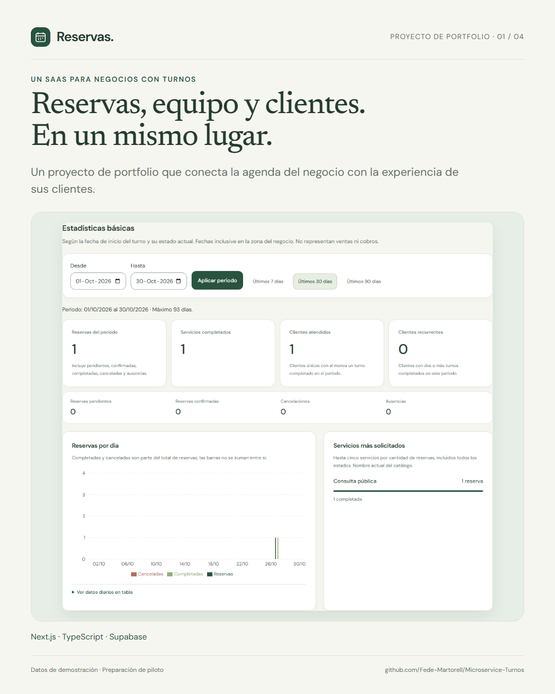
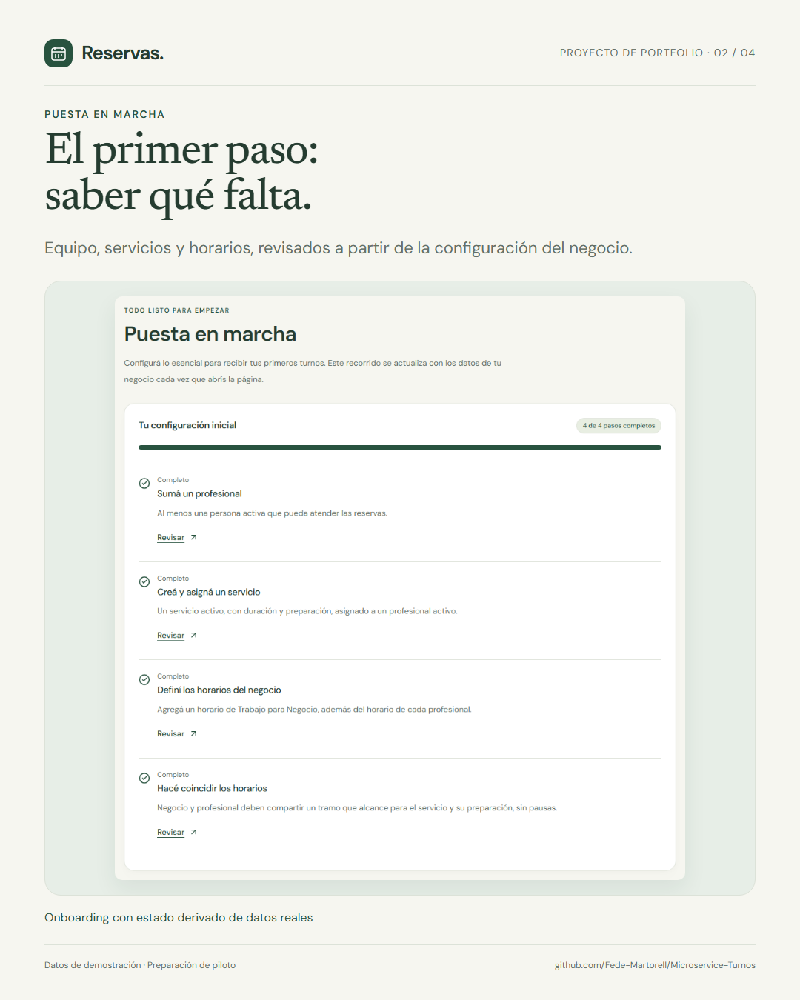

# Reservas · SaaS de gestión de negocios

Monolito modular multi-tenant para negocios con citas individuales. **Fases 1–8 implementadas; Fase 9 prepara un piloto cerrado de 1–3 negocios.** Roles owner/staff y RLS; administración SaaS separada. Puesta en marcha guiada, controles de hosting, seguridad y rendimiento medido; publicación pendiente. Sin cobros. [Operación del piloto y presupuesto](docs/pilot.md), [Railway](docs/deployment.md), [suscripciones](docs/subscriptions-and-pilots.md), [fidelización](docs/loyalty.md) y [estadísticas](docs/dashboard.md).

## Vista del proyecto

<p>
  
  
</p>

[Ver capturas y material de presentación](docs/showcase/README.md). Las imágenes usan datos sintéticos. El repositorio contiene el código; la aplicación todavía no tiene una demo pública alojada.

## Ejecutar

Node 22 LTS (22.12 o superior de esa rama) y npm 11 recomendado. Windows, macOS o Linux. Las pruebas SQL locales no requieren Docker.

```powershell
npm ci
npm run dev
```

Abrir [localhost:3000](http://localhost:3000). Registro en `/registro`, ingreso en `/ingresar` y panel en `/panel`. Inicio en `/` y roadmap en `/proyecto`. Sin configuración se muestra un aviso; no se simula acceso. Detener con Ctrl+C.

## Stack y estructura

Next.js App Router, React, TypeScript estricto, Tailwind CSS, componentes locales shadcn/ui, Lucide, React Hook Form y validación Zod en servidor. Supabase Auth/PostgreSQL con clientes SSR por petición y cookies HttpOnly. Resend para avisos transaccionales; confirmación de cuentas mediante Supabase Auth. Recharts para gráficos de reservas con tabla alternativa. Vitest, React Testing Library, Playwright, PGlite (PostgreSQL WASM solo para tests), ESLint y Prettier. Versiones exactas en package.json y lockfile.

```text
src/
  app/
    (auth)/                 # /ingresar, /registro
    (dashboard)/panel/      # Organizaciones, catálogo, equipo, disponibilidad y agenda
    auth/confirm/           # Confirmación/PKCE
    invitacion/             # Aceptación de acceso de personal
    proyecto/               # Roadmap
    b/[slug]/               # Catálogo público y reserva sin cuenta
    reserva/                # Gestión por enlace privado
    api/public-booking/     # Canje del enlace por cookie HttpOnly
  components/               # UI, layout y formularios
  features/organizations/   # Validación, consultas y acciones
  features/{services,staff,appointments,public-booking}/ # Catálogo, horarios y reservas
  features/...              # Módulos futuros reservados
  lib/                      # Auth, Supabase, permisos, entorno y errores
  hooks/
  types/                    # Contrato SQL y estados de acciones
  styles/
  proxy.ts                  # Cookies y redirección inicial
supabase/migrations/        # SQL versionado
tests/{unit,integration,e2e}/
docs/
scripts/                    # Empaquetado portable
```

## Configurar Supabase

En una instalación nueva copiar `.env.example` a `.env.local`. Si este último ya existe, editarlo sin sobrescribirlo.

| Variable                             | Uso                                                           |
| ------------------------------------ | ------------------------------------------------------------- |
| NEXT_PUBLIC_APP_URL                  | Origen de la app, local http://localhost:3000                 |
| NEXT_PUBLIC_SUPABASE_URL             | URL del proyecto autorizado                                   |
| NEXT_PUBLIC_SUPABASE_PUBLISHABLE_KEY | Clave pública del mismo proyecto                              |
| PUBLIC_BOOKING_GATEWAY_SECRET        | Credencial de servidor para RPC públicas; generada localmente |
| PUBLIC_BOOKING_TURNSTILE_SITE_KEY    | Clave visible del widget Turnstile fuera de localhost         |
| PUBLIC_BOOKING_TURNSTILE_SECRET_KEY  | Secreto de verificación Turnstile, solo servidor              |
| RESEND_API_KEY                       | Clave de Resend, solo servidor                                |
| NOTIFICATION_FROM_EMAIL              | Remitente autorizado en Fase 5                                |
| CRON_SECRET                          | Autenticación de jobs en Fase 5                               |
| NOTIFICATION_WORKER_SECRET           | Credencial de servidor acotada a la cola; BD guarda hash      |
| NOTIFICATION_MODE                    | disabled por defecto, test o live                             |
| NOTIFICATION_TEST_RECIPIENT          | Email permitido en modo test; no se redirigen correos ajenos  |

No se usa service_role. Nunca incluir secretos en código, logs ni variables NEXT_PUBLIC_. `.env.local` y `supabase-contra.txt` están ignorados por Git; la plantilla conserva placeholders.

1. En una instalación nueva aplicar, en orden, las migraciones 001–012 de `supabase/migrations/`. 003 habilita btree_gist; 004/005 reservas públicas/enlaces; 006 clientes/avisos; 007 preferencias owner; 008/009 planes y controles de acceso; 010 fidelización; 011 dashboard; 012 puesta en marcha. **Ya aplicadas en el proyecto del usuario; no repetirlas:** no son idempotentes. Success de 012 confirmado el 30/10. Cambios posteriores siempre en nuevas migraciones.
2. En Supabase Auth → URL Configuration: Site URL `http://localhost:3000` y Redirect URL permitida `http://localhost:3000/auth/confirm`. Cambiar ambos si cambia el origen.
3. Mantener Email provider y Confirm email habilitados. Plantilla predeterminada PKCE o alternativa con TokenHash documentada en [autenticación](docs/authentication.md).
4. Iniciar la app, crear una cuenta, confirmar el email e ingresar al panel para crear el negocio. Sin tarjeta ni cobros.
5. Crear profesional y servicio, asignarlos y configurar trabajo tanto para Negocio como para el profesional. En Calendario consultar una fecha con disponibilidad y crear una reserva. [Guía de catálogo](docs/catalog.md) y [reservas](docs/reservations.md).
6. En una instalación nueva ejecutar `npm run prepare:public-booking` y aplicar el SQL ignorado `supabase/.local/enable_public_booking_gateway.sql`. La clave real queda en `.env.local`; solo su hash va a BD. **Este paso también ya se aplicó en el proyecto del usuario.** No publicar esos archivos ni usar service_role. Reiniciar desarrollo si cambian variables.
7. Como owner, configurar y habilitar «Página pública» en el negocio; probar `/b/slug` y guardar el enlace privado entregado al reservar. [Configuración, límites y Turnstile](docs/public-booking.md). Antes de alojar la app, configurar su origen HTTPS real y ambas claves Turnstile; fuera de localhost la creación se cierra si faltan.
8. En una instalación nueva ejecutar `npm run prepare:notifications` y aplicar `supabase/.local/enable_notification_worker.sql` con el hash del worker. **Ya aplicado en este proyecto.** Configurar Resend y destinatario permitido; habilitar avisos en el negocio. `npm run notifications:run` es dry run, sin enviar. Para ejecución real se requiere modo test/live y `-- --send`; ver [clientes y notificaciones](docs/customers-and-notifications.md). No hay cron desplegado.
9. Preparar expresamente la cuenta administrativa con `npm run prepare:platform-admin`, revisar y aplicar su SQL local según [suscripciones y pilotos](docs/subscriptions-and-pilots.md). Abrir `/admin` con esa cuenta. El propietario ve su acceso en Negocio → Suscripción; no recibe superadmin por ser propietario.
10. Habilitar expresamente Fidelización para el negocio, configurar visitas/puntos, servicios y recompensas. El propietario registra canjes/ajustes y comparte manualmente la tarjeta privada. No envía emails ni genera cobros. [Configuración y límites](docs/loyalty.md).
11. Abrir una organización como propietario para ver Resumen: métricas, gráfico por período, turnos de hoy, próximas reservas y actividad. Configuración se encuentra en su opción del menú. El personal conserva su agenda. [Definiciones y límites](docs/dashboard.md).
12. Revisar «Puesta en marcha» para comprobar equipo, servicios y coincidencia de horarios del negocio/profesional. Preparar el piloto según [guía operativa](docs/pilot.md); la checklist no publica la página ni activa emails.

## Comandos

| Comando                                | Función                                                         |
| -------------------------------------- | --------------------------------------------------------------- |
| npm run dev                            | Desarrollo                                                      |
| npm run build                          | Build y empaquetado standalone                                  |
| npm start                              | Servidor del build                                              |
| npm run typecheck                      | Tipos de rutas y TypeScript                                     |
| npm run lint                           | ESLint sin advertencias                                         |
| npm run format / npm run format:check  | Escribir/verificar formato                                      |
| npm test / npm run test:watch          | Unitarios, componentes e integración local                      |
| npm run test:integration               | RLS SQL y guardas de servidor                                   |
| npm run test:concurrency               | Conexiones independientes a PostgreSQL local descartable        |
| npm run prepare:public-booking         | Preparar secreto local y SQL de hash del intermediario público  |
| npm run prepare:notifications          | Preparar credenciales de worker/cron y SQL con hash             |
| npm run prepare:platform-admin         | SQL local para la cuenta administrativa confirmada elegida      |
| npm run notifications:run              | Consulta de cola, sin enviar ni consumir intentos               |
| npm run notifications:run -- --send    | Procesa hasta cinco avisos según modo test/live                 |
| npm run test:e2e / npm run test:e2e:ui | Playwright contra build en puerto 3100                          |
| npm run test:e2e:public                | Reserva y gestión sin cuenta con fixture SQL aislada            |
| npm run check                          | Formato, lint, tipos, tests y build                             |
| npm run pilot:check                    | Formato de configuración de hosting, sin revelar valores        |
| npm run pilot:check -- --local         | Revisión local; no habilita publicación                         |
| npm run pilot:artifacts                | Archivos privados y secretos conocidos en el paquete            |
| npm run pilot:smoke                    | Arranque estricto y health con configuración sintética          |
| npm run pilot:measure -- after         | Medición local de portada/resumen con datos sintéticos          |
| npm run start:pilot                    | Arranque validado del standalone para hosting                   |
| npm run repo:check                     | Archivos privados/generados y secretos conocidos antes de subir |
| npm run showcase:capture               | Capturas y láminas con datos de demostración locales            |

```powershell
npx playwright install chromium webkit
npm run check
npm run test:e2e
npm run test:e2e:public
```

En Linux/CI instalar navegadores con `--with-deps`. Playwright inicia y detiene su servidor, sin reutilizar otro; el puerto 3100 debe estar libre. Reportes/capturas en playwright-report/ y test-results/, ignorados por Git.

Los E2E predeterminados aíslan la configuración y no llaman a Supabase. Para probar páginas con el proyecto configurado, sin crear cuentas ni enviar emails:

```powershell
$env:E2E_USE_CONFIGURED_SUPABASE = '1'
npm run test:e2e
Remove-Item Env:E2E_USE_CONFIGURED_SUPABASE
```

Ese smoke verifica redirecciones sin sesión y validación de formularios; no sustituye probar los recorridos con una cuenta real. El usuario confirmó organización, catálogo/horarios y creación/modificación de reservas contra Supabase. `test:e2e:public` usa un adaptador HTTP de pruebas y SQL real en PGlite, con reservas sintéticas aisladas; no escribe en Supabase. RLS ejecuta las migraciones en PostgreSQL embebido con un harness mínimo de auth.users/auth.uid; no reproduce GoTrue ni PostgREST. La prueba adicional de concurrencia requiere TEST_DATABASE_URL hacia un PostgreSQL local descartable y crea/elimina su propia base temporal; ver [instrucciones](docs/reservations.md). Resultados y límites en [progreso](docs/progress.md).

## Seguridad y alcance

Rutas privadas y acciones verifican identidad en servidor. Rol y membresía vienen de BD, nunca de user_metadata. RLS protege todas las tablas expuestas; writes de catálogo/reservas mediante RPC con autorización y auditoría atómicas. Campos editables acotados, relaciones compuestas por tenant. Recursos desactivables, reservas cancelables y sin borrado histórico. Invitaciones de un uso, con hash y vencimiento, aceptadas solo por el correo confirmado invitado. Sin service_role.

Auth usa límites del proveedor; revisar configuración y CAPTCHA antes del piloto. Límites de creación/invitaciones y bloqueo de agenda en PostgreSQL. Restricción de exclusión GiST para superposiciones, claves de reintento para evitar duplicados y versiones para detectar ediciones desactualizadas. Instantes UTC/zonas IANA; condiciones económicas históricas. PWA con manifest/iconos/standalone, sin service worker ni caché de sesiones/datos privados; no se promete operación offline.

Las RPC públicas exigen una credencial de servidor separada; la clave pública sola no da acceso. Listas permitidas de datos, cuotas persistentes, consentimiento de política, honeypot y Turnstile en hosting. Enlaces con hash y vencimiento; token en fragmento canjeado por cookie HttpOnly, sin query string ni referencias a terceros. Confirmación en pantalla y cola de emails de Fase 5, con envíos habilitados explícitamente.

## Documentación y Git

[Identidad visual y componentes](docs/design-system.md): diseño minimalista cálido, fuentes locales y navegación por permisos.

[Arquitectura](docs/architecture.md), [base de datos](docs/database.md), [autenticación](docs/authentication.md), [producto](docs/product.md), [roadmap](docs/roadmap.md), [progreso](docs/progress.md), [decisiones](docs/decisions.md) y [deploy](docs/deployment.md).

Código en [Fede-Martorell/Microservice-Turnos](https://github.com/Fede-Martorell/Microservice-Turnos). El usuario autorizó commit y push. El despliegue comercial sigue pendiente; subir código no publica la aplicación. El proyecto Supabase lo proporcionó el usuario; las pruebas automáticas no crean cuentas ni envían emails.
